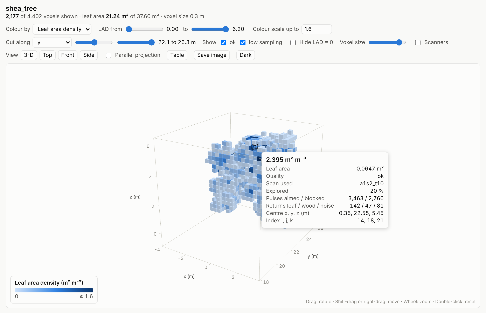

# What VoxLAD does

VoxLAD estimates leaf area density (LAD, in m² of leaf per m³) in each cubic voxel of a grid from classified ground-based lidar scans. It implements the model of Béland, Widlowski and Fournier (2014), *Environmental Modelling & Software* 51, 184–189.

For each voxel and each scan, the program compares the number of pulses the scanner aimed at the voxel with the returns recorded in front of it and inside it. The resulting transmission is inverted for LAD, with a correction for the unequal path lengths of pulses through a cube. No ray tracing of individual pulses through each voxel is required, and pulses without a return do not need to be stored.

| You provide | You get |
| --- | --- |
| One or more scans taken from fixed positions, registered in one coordinate frame | LAD and leaf area for every voxel that holds a leaf return |
| A class for each return: leaf, wood or noise | A quality flag per voxel and the scan that was used |
| For each scan: scanner position, angular step, scan pattern and field of view | All intermediate counts per voxel and scan |
| A voxel size and a leaf angle distribution | Total leaf area and its vertical profile |

The classification of returns into leaf, wood and noise is not part of VoxLAD, as it depends on the instrument, on leaf optical properties and on canopy structure. An example based on apparent reflectance is given in Béland et al. (2011), *Agricultural and Forest Meteorology* 151, 1252–1266.

This Python version replaces the MATLAB program `voxlad_v7.m`. It reproduces the MATLAB results on request, corrects several defects by default (see MATLAB compatibility below), and accepts any terrestrial scanner that samples on a regular angular pattern. At the end of a run, the voxels can be explored in three dimensions in the web browser. The program also finds from the scan itself whether the instrument was level, and checks the declared scanner position and angular step against the returns.

# Installation

VoxLAD needs Python 3.9 or newer and NumPy. Two optional packages are recommended: Numba, which makes the counting step ten to thirty times faster, and laspy for LAS or LAZ input.

```bash
cd voxlad                 # the folder that holds pyproject.toml
pip install .             # installs the voxlad package and the voxlad command
pip install numba         # recommended
pip install laspy lazrs   # only for LAS/LAZ files
```

To check the installation, print the version and run the test suite. The tests include a simulated scan of a medium of known leaf area density, which the program must recover.

```bash
voxlad --version
pip install pytest
pytest                    # from the voxlad folder; about 10 s
```

With Numba, the first run on a computer compiles the counting routine, which takes a few seconds. The compiled code is cached, and later runs start at once. Without Numba the program works the same way and gives identical counts, only more slowly; the MATLAB compatibility mode is the one feature that requires Numba.

# Quick start

The folder `examples/shea_tree` holds two scans of one shea tree taken from opposite sides with an Optech ILRIS-3D, and the configuration file below. The run takes one to two seconds.

```bash
cd examples/shea_tree
voxlad inspect shea_tree.toml     # describes each scan and checks the declared settings
voxlad run shea_tree.toml         # writes the result files in results/, then opens the 3-D viewer
```

```toml
[grid]
voxel_size = 0.3
z_range = [-1.0, 12.0]          # leave out the ground and the base of the trunk

[model]
leaf_angle = "erectophile"

[classes]
leaf = [1]
wood = [2]
noise = [3]

[scanner]
pattern = "uniform"             # ILRIS-3D: same pulse spacing in both directions

[[scan]]
file = "a1s1_t10.asc"

[[scan]]
file = "a1s2_t10.asc"

[output]
prefix = "results/shea_tree"
```

The two `.asc` files are in the original VoxLAD layout, so the scanner position, the scan limits and the angular step are read from their five-line headers. For other formats these are given in the configuration file (see Describing your scanner).

The run should end with a summary that contains these lines:

```text
voxels evaluated      4402 (voxels holding a leaf return)
  0 ok                4356 voxels   leaf area     37.188 m2
  1 low_sampling        46 voxels   leaf area      0.408 m2
Total leaf area       37.595 m2  (flags ok + low_sampling)
```

The summary of this example also carries a warning for each scan: the returns in the two files are spaced 0.0153° between scan lines and 0.0154° along them, whereas the files declare a step of 0.00026 rad (0.0149°). The example keeps the declared value; see Quality control for what this check means.

When the run is done, the result opens in the web browser as a three-dimensional view of the voxels that can be turned, zoomed and filtered (see Viewing the result in 3-D). Add `--no-view` to the command to run without opening it.

To start a project of your own, write a commented template with `voxlad template my_plot.toml` and edit it.

# The model in brief

For one voxel seen by one scan, the transmission is estimated from pulse counts (Eqs. 1 and 9 of the paper), and LAD follows from Eq. 8. The symbols are those of the paper, with Δh the voxel side.

$$T = \frac{N_G}{N_G + H\,N_I^L}, \qquad N_G = N_T - N_B - N_I^L - N_I^W - N_I^N$$

$$\mathrm{LAD} = \frac{\bar d - \sqrt{\bar d^{\,2} + 4\,\delta\,\ln T}}{2\,\delta\,G(\theta)}, \qquad \bar d = \frac{\Delta h^3}{A_{proj}}$$

$$\delta = \Delta d\,\Delta h = 0.07162\,\Delta h^2 \left[1 - \exp\left(-9.536\left(\frac{\Delta h}{\bar d} - 1\right)\right)\right]$$

| Symbol | Meaning | How it is obtained |
| --- | --- | --- |
| $N_T$ | Pulses the scanner aimed at the voxel | $A_{proj}$ divided by the area sampled by one pulse at the range of the voxel centre (see below) |
| $N_B$ | Pulses blocked before the voxel | Returns of any class lying on a line of sight from the scanner to the voxel, in front of it |
| $N_I^L$, $N_I^W$, $N_I^N$ | Pulses intercepted in the voxel | Returns inside the voxel classified leaf, wood and noise |
| $N_G$ | Pulses that crossed the voxel | By difference |
| $H$ | Beam-size correction | Setting `beam_correction`, 1 by default |
| $A_{proj}$ | Cross-section of the voxel seen from the scanner | Faces turned towards the scanner, projected on the plane through the voxel centre perpendicular to the line of sight (Fig. 3 of the paper) |
| $\bar d$ | Mean path length of the pulses through the voxel | Eq. 4 |
| $\delta$ | Path-length variability term | Eq. 7, which gives Δd/Δh; δ = Δd · Δh |
| $G(\theta)$ | Leaf projection function | Ross (1981), from the leaf angle distribution and the zenith angle θ of the line of sight |

The third equation is what accounts for Jensen's inequality: pulses cross a cube over unequal lengths, so the mean transmission is not the transmission of the mean length. Without it (δ = 0) the second equation reduces to the Beer–Lambert law with the mean path length, which underestimates LAD.

Eq. 7 was fitted for K = LAD · G · Δh up to 2.5. Compared with an exact calculation for parallel rays, the second equation is within 4% up to K = 2 for all directions of view, and within 1% on average. For denser voxels it loses accuracy, and below a transmission that depends on the direction of view it has no real solution. The setting `jensen_fit = "exact"` replaces both equations by the mean transmission of parallel rays through a cube, which has a closed form and a solution for any transmission above zero. It is an extension of the published model and is not the default.

The area sampled by one pulse depends on the scan pattern. With d the range of the voxel centre, $d_{xy}$ its horizontal range and the angular steps Δθ (zenith) and Δφ (azimuth):

$$N_T = \mathrm{round}\left(\frac{A_{proj}}{l_\theta\, l_\varphi}\right), \quad l_\theta = 2 d \tan\frac{\Delta\theta}{2}, \quad l_\varphi = \begin{cases} 2\, d_{xy} \tan\frac{\Delta\varphi}{2} & \text{spherical} \\ 2\, d \tan\frac{\Delta\varphi}{2} & \text{uniform} \end{cases}$$

The share of pulses that reached the voxel, 100 · ($N_T - N_B$) / $N_T$, is reported as *percent explored*. When several scans see a voxel, the value retained is that of the scan with the most pulses reaching the voxel, among the scans for which the second equation has a solution.

# Preparing the point clouds

VoxLAD counts pulses, so the files must hold the returns as the scanner recorded them: one file per scan position, one return per pulse, nothing removed. Five rules follow from this.

1. **One frame, z up.** All scans are registered in one Cartesian frame in metres with a vertical z axis. The leaf projection function depends on the zenith angle of each line of sight. The frame must be level; the instrument itself does not have to be (see Instrument not level).
2. **Keep every return.** Wood, ground and noise returns, and returns outside the volume of interest, all stop pulses that would otherwise have reached the voxels behind them. Restrict the computation with `bounds` or `z_range`, not by cropping the files.
3. **Do not thin or filter.** Removing duplicates, subsampling on a grid or filtering isolated points changes the pulse counts. If the scan was decimated at export, the angular step given to VoxLAD must be the step of what is in the file.
4. **One return per pulse.** With multiple-return instruments keep the first return of each pulse. When a `return_number` column or LAS field is present, VoxLAD keeps first returns by default.
5. **Keep the order of the file.** Scanner software writes the returns in the order of acquisition, one scan line after the other. VoxLAD uses that order to find the axis the scanner head turned about, and to check the declared position and angular step. A file that was sorted, tiled or merged still gives LAD values, but without these checks and with the axis taken as vertical. For LAS files that carry time stamps, the order is restored from them.

Each return carries an integer class code. The `[classes]` section says which codes mean leaf, wood and noise; several codes may share a meaning. A code that is not listed stops the run unless `unlisted` is set to `"noise"` or `"drop"`. Note that the MATLAB code and the two example files use 1 = leaf, 2 = wood and 3 = noise, whereas the text of the 2014 paper gives the order wood, foliage, noise.

| Format | Recognised by | Layout | Scanner description |
| --- | --- | --- | --- |
| `voxlad-asc` | A five-line header | Header, then `x y z class` on each line | Read from the header; the configuration file overrides it |
| `text` | Any other text file | One return per line, separated by spaces, commas or semicolons; `columns` names them; `skip_rows` skips header lines; lines starting with `#` are ignored | Configuration file |
| `las` | `.las`, `.laz` | Class from the `classification` field, or from the field named by `class_field`; needs the laspy package | Configuration file |
| `npy` | `.npy`, `.npz` | `.npy`: an n × k array described by `columns`; `.npz`: arrays named `x`, `y`, `z`, `class` and optionally `return_number` | Configuration file |

The `voxlad-asc` header is the one used by the MATLAB program:

```text
0.683 43.596 -1.526     scanner x y z
1 43                    x y of a point on the left limit of the scan, seen from the scanner
-1 43                   x y of a point on the right limit (scanner x y on both lines = 360 degrees)
r 0.00026               angular step: r for radians or d for degrees, then the value
889810                  number of returns (informative)
-0.457 23.227 5.772 3   x y z class, one return per line
```

The comments on the right are for this manual only; the header lines of a real file hold the numbers alone.

# Describing your scanner

The number of pulses aimed at each voxel is computed, not read from the data, so each scan needs four items: the scanner position, the scan pattern, the angular step and the limits of the scan. They are given once under `[scanner]` when all scans share them, or inside a `[[scan]]` entry.

**Position.** `position = [x, y, z]` is the optical centre of the scanner in the common frame, in metres.

**Pattern.** `pattern = "spherical"` is for panoramic scanners, whose head turns about an axis, normally vertical, while a mirror sweeps a line: the steps in azimuth and in polar angle about that axis are constant, and pulses get closer together towards the axis. `pattern = "uniform"` is for window scanners such as the Optech ILRIS-3D, and takes the spacing to be the same in both directions across the field of view. These correspond to `TLS_type` 2 and 1 of the MATLAB program. The uniform pattern is an approximation: a window scanner draws its lines about a horizontal axis, so that its pulses are about 1.5% denser 10° to the side of the centre of the window, and 6% denser at 20°.

**Angular step.** `angular_step_deg` or `angular_step_rad` is the angle between consecutive pulses in the file: one number, or `[azimuth, zenith]` when the two differ. This is the setting with the largest effect on the result, since $N_T$ varies with the inverse square of the step. When the file is in the order of acquisition, the run measures the spacing of the returns between scan lines and along them, and gives a warning when it differs from the declared step by more than 2%.

**Limits.** `zenith_range_deg = [min, max]` gives the vertical field of view, measured from straight up (0 is the zenith, 90 the horizon). `left_edge` and `right_edge` are the x y coordinates of any point on the left and right limits of the scan, as seen from the scanner looking at the scene; the scan is taken to cover the sector swept clockwise, seen from above, from the left limit to the right one. Omit both for a 360° scan. For a window scanner, give both the edges and the zenith range of the window. The limits are those of the instrument: when it was not level, the zenith range is counted from the axis its head turned about.

A voxel is evaluated for a scan only when it lies wholly inside these limits. Limits that are wider than the real scan make the voxels outside it look empty and fully explored, so they should be those of the scan itself.

| Instrument | `pattern` | `zenith_range_deg` | Published field of view |
| --- | --- | --- | --- |
| [RIEGL VZ-400](https://www.mertind.com/argentina/escaneres_mineria/Folleto%20VZ400.pdf) | `spherical` | `[30, 130]` | Vertical 100° (+60° / −40°), horizontal up to 360°; step 0.0024° to 0.288° vertical, 0.0024° to 0.5° horizontal |
| [RIEGL VZ-400i](https://products.rieglusa.com/product/terrestrial-scanners/vz-400i-3d-laser-scanning-system) | `spherical` | `[30, 130]` if the split is that of the VZ-400 | Vertical 100°, horizontal 360° |
| [Leica RTC360](https://atgusa.com/?p=16308) | `spherical` | `[0, 150]` | Vertical 300°, horizontal 360°; point spacing 3, 6 or 12 mm at 10 m |
| [FARO Focus3D](https://knowledge.faro.com/Hardware/Focus/Focus/Performance_Specifications_for_the_Focus3D) | `spherical` | `[0, 152.5]` | Vertical 305°, horizontal 360°; finest step 0.009° |
| [Optech ILRIS-3D](https://unavco.knowledgebase.co/assets/801/ILRIS_Spec.pdf) | `uniform` | That of the window | 40° × 40° window; finest step 20 µrad |

The zenith ranges of the Leica and FARO instruments assume that the blind cone is centred below the scanner. These figures are those of the data sheets and are given as a starting point: the limits and the step of a particular scan are those chosen at acquisition and at export, and should be taken from the scan project.

`voxlad inspect` reports, for each scan, the zenith angles and bearings covered by the returns next to the declared limits. It also compares the densest patches of returns with what the declared step allows: where a surface returns every pulse, the ratio is close to 100%. A ratio well above 100% means that the step is finer than declared, that the pattern is wrong, or that the file holds several returns per pulse.

```text
scan 'a1s1_t10': 911282 returns used
  zenith angles  73.4..96.6 deg seen; declared field of view 0.0..180.0
  bearings       350.7..8.8 deg clockwise from +y seen (span 18.1 deg)
  declared sector 270.0..90.0 deg (180.0 deg wide); 100.0% of returns inside
  densest patches hold 95% of the pulses the declared step allows
```

## Instrument not level

The pulse count of the spherical pattern rests on the axis around which the scanner head turns: the pulses are equally spaced in azimuth and in polar angle about that axis, not about the vertical. When the instrument leans by a small angle τ, taking its axis as vertical puts $N_T$ off by about τ / tan θ, where θ is the angle between the voxel and the axis, with opposite signs on the side the instrument leans to and on the other side. A lean of 1° changes $N_T$ by 0.3% at 10° of elevation, 1% at 30°, 3% at 60° and 6.5% at 75°. The effect on LAD is larger, since only the pulses that enter a voxel carry the estimate: in a simulated canopy 60° above the scanner, a lean of 1° changed LAD by about 5%, and a lean of 3° by 12 to 19%.

VoxLAD therefore finds the axis of each panoramic scan from the scan itself. The returns of one sweep of the mirror lie on a surface that turns with the head: a plane through the axis for an ideal instrument, a flat cone for an instrument with a polygon mirror. The scan lines are taken from the order of the returns in the file, and the axis is the direction about which all of them fit, in the least-squares sense. No reading from the instrument and no registration matrix is needed. The axis found is used for $N_T$, for the limits of the scan and for the test that excludes voxels lying on the axis. The leaf projection function keeps to the vertical of the common frame.

The summary and `voxlad inspect` report what was found for each scan. The lines below, folded to fit the page, are those of a real scan of a RIEGL VZ-400 whose point cloud was turned by 1.7° for the test:

```text
head axis      tilted 1.70 deg from the vertical, towards bearing 127 deg
               (found from 986 scan lines, +-0.001 deg)
               taken as vertical, this tilt would put N_T off by up to 1.8% at 30 deg
               elevation and 5.2% at 60 deg; it is accounted for
scan lines     986 lines analysed; cones of 1.04 deg; they meet 0 mm from the declared
               position; returns lie 0.3 mm from their line
               spacing of the returns: 0.040088 deg between lines, 0.039968 deg along them
               (declared step 0.04 x 0.04)
```

The same analysis gives two checks that do not depend on the tilt. First, the scan lines meet at the scanner, so that a declared position which is off across the axis is found; a warning is given beyond 10 cm. An error along the axis, i.e. in the height of an upright scanner, cannot be seen in this way. Second, the spacing of the returns between scan lines and along them is compared with the declared angular step.

The axis is accepted only when the returns lie within half a line spacing of their lines and when its standard error, taken from the scatter between eight subsets of lines, is below 0.05°. Otherwise the axis is taken as vertical and the summary says why. This happens when the file is not in the order of acquisition, when the scan covers only a few degrees, or when the returns do not line up as seen from the declared position.

| `axis` | Head axis used |
| --- | --- |
| `"auto"` (default) | Found from the scan lines; if that fails, the z axis of the registration matrix when one is given, otherwise the vertical |
| `"vertical"` | The vertical, as in version 1.1 and in the MATLAB program |
| `[x, y, z]` | The direction given, in the common frame |
| `"matrix"` | The z axis of the registration matrix |

`matrix` (16 numbers) or `matrix_file` (a text file that holds them) gives the registration matrix of a scan, i.e. the 4 × 4 matrix that takes the scanner's own coordinates to the common frame, such as the SOP matrix of RiSCAN PRO. The scanner's own z axis is taken as its head axis, and the translation as the scanner position when `position` is absent. The axis found from the scan lines is preferred to that of the matrix, since software that levels the cloud with the inclination sensors leaves a matrix which no longer holds the lean of the instrument. A warning is given when the two differ by more than 0.2°.

Scans taken with the instrument on a tilt mount are handled in the same way; the axis found is then close to horizontal. For such a scan, `zenith_range_deg` is the range of the scan lines counted from the head axis, and `left_edge` and `right_edge` need three coordinates, x y z, since two no longer define the limits.

Three limits should be kept in mind. First, the correction concerns the instrument and not the frame: a cloud left in the scanner's own tilted frame has a correct $N_T$ but wrong zenith angles, and should be levelled before use. Second, with the uniform pattern the pulse count does not depend on the axis, and the scan lines are analysed for the two checks only. Third, the method was tested on scans of a single instrument model, the RIEGL VZ-400, and on simulated scans (see Validation). The description of the scan lines is general, but other instruments remain to be tested.

# Configuration file reference

A run is described by one text file in TOML format; `voxlad template` writes a commented one. File names in it are relative to the folder of the configuration file. A misspelled setting stops the run with a message that lists the valid names.

## [grid]

| Setting | Default | Meaning |
| --- | --- | --- |
| `voxel_size` | required | Side of the cubic voxels, in metres |
| `bounds` | Extent of the leaf returns, extended to whole metres | `[xmin, ymin, zmin, xmax, ymax, zmax]` of the grid |
| `z_range` | none | `[zmin, zmax]`: limits the automatic grid to these heights. Returns outside still count as blocking. Not used when `bounds` is given |
| `voxels` | `"leaf"` | `"leaf"` evaluates the voxels that hold at least one leaf return; `"all"` evaluates every voxel of the grid, which tells empty voxels (LAD = 0) from unseen ones |

## [model]

| Setting | Default | Meaning |
| --- | --- | --- |
| `leaf_angle` | `"spherical"` | `"erectophile"`, `"planophile"`, `"plagiophile"`, `"spherical"` or `"uniform"` (the nine-class tables of the MATLAB code), or a list of leaf area fractions for equal inclination classes from 0° (horizontal leaf) to 90° |
| `beam_correction` | 1 | Factor H applied to the leaf returns in a voxel: a number, one value per leaf angle class, or `"ilris3d-20m"` for the table of the MATLAB code |
| `min_percent_explored` | 15 | Voxels whose percent explored is below this value are flagged `low_sampling` |
| `jensen_fit` | `"paper"` | Treatment of the unequal path lengths: `"paper"` (Eq. 7), `"exact"` (closed form for parallel rays, an extension of the paper), `"matlab"` (the constant of the MATLAB code, valid for 0.3 m voxels only), `"matlab-scaled"` (the same, scaled with voxel size) or `"none"` (no correction) |
| `unresolved` | `"nan"` | Value written when the LAD equation has no solution: `"nan"`, `"beer"` (Beer–Lambert law with the mean path, a lower bound) or `"zero"` (as the MATLAB code) |
| `best_scan` | `"entering"` | Scan retained for a voxel: `"entering"`, the most pulses reaching the voxel, or `"fraction"`, the highest percent explored |
| `min_range_voxels` | 2 | A scan is not used for voxels closer to the scanner than this number of voxel sides |
| `compat` | `"none"` | `"matlab"` reproduces the MATLAB program (see MATLAB compatibility) |
| `engine` | `"traversal"` | Counting method; `"matlab"` applies the tests of the MATLAB code to every return and voxel |
| `threads` | all cores | Number of threads used for counting |

The beam-size correction H removes the returns triggered by pulses whose centre missed the leaf (Béland et al. 2011). The `"ilris3d-20m"` table was derived for the ILRIS-3D at about 20 m range and for one leaf size; with the erectophile distribution it amounts to H = 0.74. It should not be applied to other instruments.

## [classes]

| Setting | Default | Meaning |
| --- | --- | --- |
| `leaf`, `wood`, `noise` | `[1]`, `[2]`, `[3]` | Class codes found in the files for each category |
| `unlisted` | `"error"` | What to do with other codes: `"error"`, `"noise"` (count them as noise) or `"drop"` (remove the returns) |

## [scanner] and [[scan]]

Settings under `[scanner]` apply to every scan; each `[[scan]]` entry describes one scan and may repeat any of them. `file` is the only setting that every `[[scan]]` needs when the files are in the `voxlad-asc` layout.

| Setting | Default | Meaning |
| --- | --- | --- |
| `file` | required | Point cloud of the scan |
| `name` | File name without extension | Label used in the outputs |
| `format` | `"auto"` | `"voxlad-asc"`, `"text"`, `"las"` or `"npy"` |
| `position` | From the header, otherwise required | Scanner x y z |
| `pattern` | required | `"spherical"` or `"uniform"` |
| `angular_step_deg`, `angular_step_rad` | From the header, otherwise required | One number or `[azimuth, zenith]`; give one of the two settings |
| `left_edge`, `right_edge` | From the header, otherwise 360° | x y of a point on each limit of the scan; x y z for an instrument far from level |
| `zenith_range_deg` | `[0, 180]` | Vertical field of view from the zenith, or from the head axis of an instrument that was not level |
| `axis` | `"auto"` | Axis the scanner head turned about: `"auto"`, `"vertical"`, `"matrix"` or `[x, y, z]` (see Instrument not level) |
| `matrix`, `matrix_file` | None | Registration matrix of the scan, as 16 numbers or as a text file that holds them |
| `columns` | `["x", "y", "z", "class"]` | Column names of text and `.npy` files; `"return_number"` is recognised, any other name is ignored |
| `skip_rows` | 0 | Header lines to skip in text files |
| `delimiter` | Detected | Column separator of text files |
| `returns` | `"auto"` | `"auto"` keeps first returns when a return number is present; `"first"` requires one; `"all"` keeps everything |
| `class_field` | `"classification"` | LAS field that holds the class |

## [output]

| Setting | Default | Meaning |
| --- | --- | --- |
| `prefix` | `"voxlad"` | Start of the output file names, with an optional folder |
| `per_scan` | true | Write the table with one line per voxel and scan |
| `npz` | false | Write the results as three-dimensional NumPy arrays |
| `matlab_text` | false | Write a result file laid out as that of the MATLAB program |
| `viewer` | true | Write the 3-D viewer of the result, `_viewer.html` |
| `open_viewer` | true | Open the viewer in the web browser at the end of `voxlad run` |

## Command line

`voxlad run CONFIG` accepts `-o PREFIX`, `--voxel-size`, `--compat`, `--threads` and `-q` (quiet), which override the file, and `--no-view`, which leaves the 3-D viewer closed. `voxlad inspect CONFIG` describes the scans without running the model. `voxlad view PATH` opens the viewer of a finished run, where PATH is the configuration file, a `_voxels.csv` file or a `_viewer.html` file; `--rebuild` writes the page again from the voxel table and `--no-open` leaves the browser closed.

# Outputs

A run writes four files, plus two optional ones; all names start with the output prefix. Undefined values are written as `nan`.

| File | Content |
| --- | --- |
| `_voxels.csv` | One line per evaluated voxel: the final LAD, its quality flag and the scan it comes from |
| `_scans.csv` | One line per voxel and scan, with every intermediate quantity |
| `_summary.txt` | Settings, returns per scan, voxels per flag, total leaf area, leaf area by height, warnings |
| `_viewer.html` | The voxels in three dimensions, to open in a web browser (see Viewing the result in 3-D) |
| `_grid.npz` (optional) | Arrays `lad`, `flag`, `best_scan` and `percent_explored` of shape (nx, ny, nz), with `origin` and `voxel_size`; `flag` is −1 for voxels that were not evaluated |
| `_matlab.txt` (optional) | The layout of the MATLAB program: lower corner of the voxel, LAD and percent explored for each scan, best scan |

## Columns of the voxel table

| Column | Meaning |
| --- | --- |
| `i`, `j`, `k` | Index of the voxel along x, y and z, from 0 |
| `x`, `y`, `z` | Centre of the voxel (m) |
| `lad` | Leaf area density (m² m⁻³) |
| `leaf_area` | `lad` times the voxel volume (m²) |
| `flag` | Quality flag, see below |
| `best_scan` | Number of the scan used, in the order of the configuration file; 0 if none |
| `percent_explored` | 100 · ($N_T - N_B$) / $N_T$ for that scan |
| `nt`, `nb`, `ni_leaf`, `ni_wood`, `ni_noise` | Pulse counts of that scan |

The scan table repeats `i`, `j`, `k` and adds `scan`, `status`, `zenith_deg` (zenith angle of the line of sight), `polar_deg` (its angle from the head axis of the scan, equal to `zenith_deg` for a level instrument), `range` (m), `aproj` (m²), `d_bar` (m), `G`, the pulse counts with `ng`, `percent_explored`, `transmission` and the `lad` of that scan alone.

## Quality flags and scan status

| `flag` | Name | Meaning | `lad` |
| --- | --- | --- | --- |
| 0 | ok | A scan gives a solution and at least `min_percent_explored` of its pulses reached the voxel | Value |
| 1 | low_sampling | As above, but fewer pulses reached the voxel | Value, less reliable |
| 2 | unresolved | Pulses entered the voxel, but no scan gives a solution | `nan`, or the fallback chosen with `unresolved` |
| 3 | occluded | Inside the field of view of a scan, but no pulse reached the voxel | `nan` |
| 4 | not_seen | Outside the field of view of every scan, or too close to the scanner | `nan` |

| `status` | Name | Meaning for one voxel and one scan |
| --- | --- | --- |
| 0 | ok | LAD computed |
| 1 | not_covered | The voxel is not wholly inside the limits of the scan |
| 2 | too_close | The scanner is inside the voxel, closer than `min_range_voxels`, or the voxel sits on the vertical axis of a spherical scan |
| 3 | no_pulses | $N_T$ rounds to zero |
| 4 | occluded | $N_T - N_B$ is zero or negative |
| 5 | no_gap | Every pulse that entered was intercepted ($N_G \le 0$) |
| 6 | no_solution | The transmission is too low for the LAD equation to have a real solution |

# Viewing the result in 3-D

Every run writes `_viewer.html`, a page that shows the evaluated voxels in three dimensions, and `voxlad run` opens it in the default web browser when the run is done. The page holds the values of the run and the drawing code in a single file. Nothing has to be installed to use it, it works without an internet connection, and it can be sent to a colleague, who opens it with a double-click.



Each voxel is drawn as a cube at its place in the coordinate frame of the scans, with axes in metres. The line under the title gives the number of voxels shown and their leaf area, next to the total leaf area of the run (flags ok and low_sampling, as in the summary).

## Moving around

| Action | Mouse or trackpad | Keyboard | Touch screen |
| --- | --- | --- | --- |
| Turn | Drag | Arrow keys | Drag with one finger |
| Move sideways | Shift + drag, or drag with the right button |  | Drag with two fingers |
| Zoom | Wheel, or scroll with two fingers | `+` and `-` | Pinch |
| Back to the first view | Double-click | `0` or Home |  |

The buttons 3-D, Top, Front and Side set the direction of view: Top looks down on the plot with x to the right and y up, Front looks along y, and Side looks along x. These three views use a parallel projection, in which a voxel keeps the same size at any distance, so they read as a plan and two elevations. The Parallel projection box applies it to any view. The keyboard acts on the view once it has been clicked.

## What the colours show

| Colour by | Shows | Typical use |
| --- | --- | --- |
| Leaf area density | LAD from light (0) to dark; voxels without a value are grey | Where the foliage is |
| Percent explored | Share of the pulses aimed at the voxel that reached it | Where occlusion weakens the estimate |
| Quality flag | ok, low sampling, unresolved, occluded or not seen | Which voxels to treat with caution |
| Scan used | The scan from which the final LAD is taken | How the scans share the canopy |

For LAD, the dark end of the scale is set by "Colour scale up to". It starts at the 98th percentile of the run, rounded up, so that a few very dense voxels do not flatten the colours of all the others; voxels above it take the darkest colour. With more than eight scans, the scans after the eighth share one colour.

## Filters

- **LAD from ... to** keeps the voxels whose LAD lies between the two sliders. Raising the lower one removes the sparse outer voxels and shows the dense parts of the crown.
- **Cut along** x, y or height keeps the slab between two positions on that axis, which opens the canopy to show its inside or isolates one layer. Cuts on the three axes add up, so that a box can be cut out of the canopy; Reset cuts removes them.
- **Show** has one box per quality flag found in the result; clearing a box hides the voxels with that flag.
- **Hide LAD = 0** removes the voxels that hold a leaf return but for which the model gives zero.
- In the Scan used colouring, a click on a scan in the legend hides or shows the voxels taken from it.
- **Voxel size** shrinks the cubes, to see between them.
- **Scanners** marks the scanner positions and zooms out to bring them into view.

## Reading values

Pointing at a voxel shows its LAD, leaf area, quality flag, scan used, percent explored, the pulses aimed at it and blocked in front of it ($N_T$ and $N_B$), its leaf, wood and noise returns, its centre and its index. These are the values of the voxel table. The Table button lists the voxels shown, the 500 with the highest LAD first, and the legend gives the number of voxels per quality flag or per scan.

Save image writes the current view as a PNG file with its axes and legend, and Dark or Light switches the background.

## Opening the viewer again, or not at all

```bash
voxlad view shea_tree.toml                 # opens the viewer of that run
voxlad view results/shea_tree_voxels.csv   # the same, from its voxel table
voxlad run shea_tree.toml --no-view        # runs without opening the viewer
```

To stop the viewer from opening for every run of a configuration file, as when many plots are processed in a loop, set `open_viewer = false` under `[output]`; `viewer = false` also stops the file from being written. `voxlad view` writes the page from the voxel table when the page is missing or older than the table, and always with `--rebuild`. A page written from a voxel table lacks the scanner positions and the scan names, which the table does not hold. On a computer without a graphical session, such as a remote shell or a cluster node, no browser is started: the run prints the path of the page, which can be copied to another computer and opened there.

## Limits

The page needs a browser with WebGL 2, which current versions of Firefox, Chrome, Edge and Safari provide. Its size is about 50 bytes per voxel on top of 45 kB: 0.26 MB for the example and about 50 MB per million voxels. Values are stored with seven significant digits. Arrays of several hundred thousand voxels load and display correctly (tested with 600,000), but how smoothly they turn depends on the graphics hardware of the computer. When more than 120,000 voxels are shown, those enclosed by six shown neighbours are not drawn, since they cannot be seen, unless the cubes are shrunk below 85 % of the voxel size.

# Quality control

A LAD value is only as good as the sampling of its voxel, so the flags and the percent explored should be examined before the values are used. The summary file gives the number of voxels and the leaf area under each flag.

**Occlusion.** Material between the scanner and a voxel stops part of the pulses aimed at it. As the percent explored decreases, the estimate rests on fewer pulses and becomes sensitive to small errors in $N_T$. Béland et al. (2011) used a threshold of 15% for the explored volume, which is the default of `min_percent_explored`. The total leaf area is reported with and without the voxels flagged `low_sampling`.

**Dense voxels.** When all, or nearly all, of the pulses that entered a voxel were intercepted, the LAD equation has no real solution. The limit depends on the direction of view: there is none for a voxel seen face-on, while the transmission must exceed about 6% when Δh/d̄ = 1.2 and about 31% for a voxel seen along its diagonal. Such voxels are flagged `unresolved`, and the summary states how many leaf returns they hold. They are among the densest voxels, so a large number of them means that the total is underestimated. Two settings address this: `jensen_fit = "exact"` has a solution whenever at least one pulse crossed the voxel, and `unresolved = "beer"` gives a lower bound.

**Voxels with leaf returns and LAD = 0.** A voxel is evaluated when any scan recorded a leaf return in it, but its value comes from the scan with the most pulses reaching it. That scan may have recorded no leaf return there. The scan table shows what each scan saw.

**Angular step.** If more returns are found in and in front of a voxel than the number of pulses the declared step allows, the step is too coarse, the pattern is wrong or the file holds several returns per pulse. The run prints a warning when this affects more than 10% of the voxels of a scan. A second, more sensitive check uses the scan lines when the file is in the order of acquisition: the spacing of the returns between lines and along them is measured and compared with the declared step, and a warning is given beyond 2%. On two scans of a RIEGL VZ-400 this measurement was within 0.3% of the step of the pulses themselves. A step that is 3% too small makes $N_T$ 6% too large, and in the example tree this lowers the total leaf area by about 17%: the total is 37.6 m² with the step declared in the example files and 45.4 m² with the spacing found in them. When the warning appears, the step should be checked against the settings of the instrument, and corrected with `angular_step_deg = [between lines, along lines]` if the spacing found is the right one.

**Scanner position and tilt.** The scan lines of a scan meet at the scanner and turn about the axis of its head. The run reports the tilt of that axis and uses it (see Instrument not level), and gives a warning when the lines meet more than 10 cm from the declared position.

**Voxel size.** The model assumes that leaves are randomly distributed within a voxel, so the total leaf area depends on the voxel size where foliage is clumped. For the example tree and default settings:

| Voxel size (m) | 0.10 | 0.15 | 0.20 | 0.30 | 0.50 | 1.00 |
| --- | --- | --- | --- | --- | --- | --- |
| Total leaf area (m²) | 43.5 | 41.2 | 39.6 | 37.6 | 35.8 | 32.7 |

The choice of a voxel size is outside the scope of the 2014 paper. Voxels should remain large compared with the pulse spacing, so that $N_T$ is counted in hundreds or thousands; the `nt` column gives its value.

# MATLAB compatibility

Setting `compat = "matlab"` makes the program follow `voxlad_v7.m` step by step, so that earlier results can be reproduced and compared. By default the program departs from the MATLAB code on the points below; the companion code review document gives the evidence for each.

| Aspect | MATLAB program and `compat = "matlab"` | Default |
| --- | --- | --- |
| Path-length term | Constant 0.006239 m², right for 0.3 m voxels only | Eq. 7 of the paper, scaled with the voxel size |
| Voxels more than 5° below scanner height | LAD = 0, because G becomes a complex number | Computed, with G(θ) = G(180° − θ) |
| No real solution, or no gap | LAD = 0 | `nan` and a flag, or a fallback on request |
| Returns lying exactly on a voxel face | Counted as blocked pulses for the voxels on both sides | Belong to the voxel on the upper side |
| Voxels whose own extent in x, y or z contains the scanner coordinate, for instance the layer of voxels at scanner height | Part of the blocked pulses is missed, up to several percent | Exact |
| Limits of the scan | Centre of the voxel; the sector behind the scanner is accepted as well; no lower limit in zenith | Whole voxel inside the sector and inside both zenith limits |
| Height limits | Returns outside are discarded, including as blocking returns | Only limit the grid |
| Scan retained for a voxel | Most pulses reaching the voxel, even when it gives no solution | Most pulses reaching the voxel among the scans with a solution |
| Extent of the automatic grid | All returns | Leaf returns |
| Instrument not level | Axis of the scanner taken as vertical | Axis found from the scan lines (`axis = "auto"`) |

To reproduce a MATLAB run, translate its settings as follows and set `matlab_text = true` to obtain the same file layout.

| MATLAB variable | Configuration file |
| --- | --- |
| `vox_size` | `voxel_size` |
| `TLS_type = 1` | `pattern = "uniform"` |
| `TLS_type = 2`, `max_zen` | `pattern = "spherical"`, `zenith_range_deg = [max_zen, 180]` |
| `g = erecto` (or `plano`, `spheri`, `plagio`, `uniform`) | `leaf_angle = "erectophile"` (and so on) |
| `flag_H = 1` | `beam_correction = "ilris3d-20m"` |
| `min_canopy_height`, `max_canopy_height` | `z_range = [min, max]` |

Three features of `voxlad_v7.m` are deliberately not reproduced. Coordinates are held in double precision, whereas v7 stores them in single precision; the debug lines `here` and `there` that v7 writes into its result files are omitted; and the last layer of voxels along an axis, which v7 can lose or fail on, is processed. The compatibility mode requires Numba and is slow, since it tests every return against every voxel.

# Speed and memory

The two example scans (1.8 million returns, 4,402 voxels of 0.3 m) are processed in 0.3 to 0.5 s, after about 0.6 s spent reading the text files and about 1 s per scan spent on the analysis of the scan lines. The timings below were measured on two cores, with Numba installed unless stated.

| Case | Time (s) |
| --- | --- |
| Reading the two `.asc` files, 1.8 million returns | 0.6 |
| Analysis of the scan lines (tilt, position and step), per scan | 0.5 to 1.5 |
| Example, 0.3 m voxels (4,402 voxels) | 0.3 to 0.5 |
| Example, 0.1 m voxels (41,026 voxels) | 0.7 |
| Ten times the returns (18 million), 0.1 m voxels | 5 |
| Example, 0.3 m voxels, counting step without Numba | 4 to 7, depending on the NumPy build |
| Example with `compat = "matlab"` (4,413 voxels) | 12 |

Each return is followed once through the grid, from its position onward along its line of sight, and every voxel crossed on the way receives one blocked pulse. The time therefore grows with the number of returns and with the number of voxels a pulse crosses, but not with the number of voxels evaluated. The MATLAB algorithm, kept in the compatibility mode, tests every return against every voxel.

Memory use is roughly 25 bytes per return once loaded, 5 bytes per voxel of the whole grid, and a few hundred bytes per evaluated voxel. For large scans, NumPy or LAS files are read much faster than text, and `bounds` keeps the grid to the volume of interest.

# Using VoxLAD from Python

The command line is a thin layer over four functions: `run` executes a configuration file, `compute` works on arrays already in memory, `write_results` writes the files, and `view` opens the 3-D viewer.

```python
import numpy as np
import voxlad

# 1. Run a configuration file; keyword arguments override its settings
res = voxlad.run("shea_tree.toml")
res = voxlad.run("shea_tree.toml", voxel_size=0.2, write=False)
res = voxlad.run("shea_tree.toml", view=True)    # also opens the 3-D viewer

# 2. Or build the scans from arrays: classes are 1 leaf, 2 wood, 3 noise
scan = voxlad.Scan(xyz, cls, position=[0.0, 0.0, 1.5], pattern="spherical",
                   step_az=np.radians(0.04), step_zen=np.radians(0.04),
                   zenith_min=np.radians(30), zenith_max=np.radians(130))
res = voxlad.compute([scan], voxlad.Settings(voxel_size=0.25, leaf_angle="spherical"))
# axis="auto" is the default: the head axis is found from the scan lines when xyz is in file order.
# Other choices: axis="vertical", axis=[x, y, z], or matrix=M (4 x 4 registration matrix)

# 3. Use the result
res.lad, res.flag, res.best_scan, res.explored   # one value per evaluated voxel
res.ijk, res.lo                                  # grid indices and lower corners (m)
res.per_scan["nb"]                               # arrays of shape (voxels, scans)
res.total_leaf_area()                            # m2, flags ok and low_sampling
res.scan_axes[0]["tilt_deg"]                     # lean of the first scanner; also "axis", "source", "text"
est = voxlad.estimate_axis(xyz, position, step)  # the analysis of the scan lines on its own
lad3d = res.grid("lad")                          # (nx, ny, nz) array, nan where no value
print(voxlad.summary_text(res))
voxlad.write_results(res, "out/run", npz=True)   # the files, with out/run_viewer.html
voxlad.view(res)                                 # the 3-D viewer, in the web browser
voxlad.write_viewer(res, "out/tree.html")        # only write the page
```

`Settings` takes the settings of the `[grid]` and `[model]` sections under the same names. The keys of `res.per_scan` are the column names of the scan table, with `explored` for the percent explored. Errors in the input raise `voxlad.InputError` with a message meant for the user. Unlike the command line, `run` opens the viewer only when `view=True` is given, so that scripts and loops do not open browser windows unasked.

# Assumptions and limitations

The estimates rest on the assumptions of the 2014 model and on a few choices of this implementation, which should be kept in mind when the results are interpreted.

- **Fixed scan positions and a regular pattern.** $N_T$ is derived from the position of the scanner and its angular step. Mobile, handheld and airborne lidar, for which there is no single position, are not supported.
- **Level frame, instrument found from the file.** The z axis of the common frame is taken as the true vertical. The axis of each scanner is found from its scan lines, which requires a file in the order of acquisition; otherwise it is taken as vertical unless it is given. This was tested on one instrument model, the RIEGL VZ-400.
- **One return per pulse.** Each pulse is either intercepted or transmitted. The partial interception of a beam by a leaf edge is only accounted for through the beam-size correction H, which is specific to an instrument, a range and a leaf size.
- **Turbid medium.** Leaves are taken to be small compared with the voxel and randomly placed within it. Clumping inside a voxel is not corrected, hence the dependence on voxel size shown above.
- **Theoretical pulse count.** The pulse spacing is evaluated at the voxel centre and the pulses are treated as parallel within a voxel. The original code estimated the resulting error on $N_T$ at 0 to 2% for typical configurations; it grows close to the scanner, and near the vertical axis of a spherical scan.
- **Classification.** Wood and noise returns are removed from the pulses available to leaves, so classification errors propagate directly to LAD.
- **One scan per voxel.** The scans are not pooled: the value of a voxel comes from a single scan.
- **One leaf angle distribution.** The same distribution applies to every voxel.
- **Memory.** The grid is limited to 4 × 10⁸ voxels; larger plots are processed in blocks with `bounds`.
- **Even illumination of a voxel.** The pulses that reach a voxel are taken to be spread evenly over its cross-section. Behind other foliage this is not exactly so, and in simulations of a uniform medium the voxels partly shaded by their neighbours were overestimated by 2 to 7% (see Validation).

# Troubleshooting

Input problems stop the run with a one-line message that names the setting or file to correct. The most common situations are listed here.

| Message or symptom | Likely cause | What to do |
| --- | --- | --- |
| `class codes [...] are not assigned to leaf, wood or noise` | The files use codes that `[classes]` does not list | List them, or set `unlisted` |
| `no voxel contains a leaf return` | Wrong leaf code, or `bounds` / `z_range` exclude the canopy | Check `[classes]` and the grid with `voxlad inspect` |
| `the grid would have ... voxels` | Automatic grid over a very large scene | Set `bounds` to the plot, or increase `voxel_size` |
| `'pattern' is required` | No scan pattern given | Add `pattern` under `[scanner]` |
| Warning: more returns than pulses the declared angular step allows | Step too coarse, wrong pattern, several returns per pulse, or merged scans in one file | Check with `voxlad inspect`; give one file per scan position |
| Many voxels flagged `low_sampling` or `occluded` | Occlusion | Add scan positions; use larger voxels; restrict the analysis to well-sampled voxels |
| Many voxels flagged `not_seen` | Limits of the scans narrower than the grid, or scanner inside the canopy | Check `zenith_range_deg`, `left_edge` and `right_edge` |
| LAD far too high or too low everywhere | Angular step wrong by a constant factor | $N_T$ varies with the inverse square of the step: check its unit (degrees or radians) and value |
| Results differ from the MATLAB program | Corrections applied by default | Use `compat = "matlab"` to compare |
| `the MATLAB-compatible engine needs numba` | Numba is not installed | `pip install numba` |
| The run is slow | Numba is not installed, or first run | `python -c "import numba"` should print nothing |
| `the tilt could not be found from the returns` in the summary | File not in the order of acquisition, scan of a few degrees only, or wrong scanner position | Nothing if the instrument was level; otherwise export the scan in its original order, or give `axis` or `matrix_file` |
| Warning: the returns are spaced ... where the declared angular step is ... | Declared step rounded or wrong, or the file was thinned regularly | Check the step in the scan project; set `angular_step_deg = [between lines, along lines]` |
| Warning: its scan lines meet ... m from the declared scanner position | Wrong `position`, positions of two scans exchanged, or a frame that was moved after registration | Check `position` against the registration of the scan |
| `Give left_edge and right_edge as [x, y, z] points` | Scanner on a tilt mount with limits given by two coordinates | Add the third coordinate of each edge point |
| The 3-D viewer does not open at the end of a run | No graphical session on the computer (remote shell, cluster node), `--no-view`, or `open_viewer = false` | Copy the `_viewer.html` file to your own computer and open it in a web browser |
| The viewer page says that WebGL 2 is needed, or stays empty | Old browser, or hardware acceleration turned off | Open the file in a current Firefox, Chrome, Edge or Safari and turn hardware acceleration on in its settings |
| The viewer turns slowly | Very large voxel array for the graphics hardware | Raise the lower LAD slider or cut the array to draw fewer voxels |

# Validation

The Python version was checked in five ways; the scripts and the reference outputs are in the `validation` and `tests` folders of the package, so each check can be repeated.

**Against the MATLAB code.** The original `voxlad_v7.m` was run in GNU Octave 8.4 on the example scans, with file paths changed and nothing else that affects a result. In compatibility mode the Python functions reproduce every pulse count of the 5,760 voxel-scan records of these runs, and all 2,880 result lines are identical to the printed digit. The runs cover the whole grid on scans thinned 1:400 and 1:100, and 24 voxels on the full scans. Run end to end with its own grid, the compatibility mode evaluates the same 2,016 voxels as Octave on the 1:100 scans, and 19 of the 4,032 records differ by one return that lies exactly on a voxel face.

**Counting engine.** On the example scans, the default engine gives the same $N_B$ and $N_I$ as a brute-force intersection test for 400 voxel-scans drawn at random. It also gives the same $N_B$ as the MATLAB rules for all 8,256 voxel-scans in which the scanner lies outside the extent of the voxel along x, y and z; the remaining 560 are those for which the MATLAB rules are in error.

**Simulated scans.** A box of 64 voxels filled with a uniform turbid medium of known LAD was scanned from two positions with each scan pattern. The theoretical $N_T$ was within 2.5% of the number of simulated pulses crossing each voxel, and within 0.5% on average. The recovered LAD, averaged over the box, was 0.50 for a true value of 0.5, 1.01 to 1.02 for 1.0, and 3.14 to 3.16 for 3.0.

**Path-length term.** For single simulated voxels of 0.5 m with LAD of 1 to 6 m² m⁻³, both Eq. 7 with Eq. 8 and the exact option recover LAD within 4%, whereas the estimate is up to 18% too low without a correction.

**Instrument not level.** On simulated panoramic scans tilted by 0 to 90°, with scan lines drawn as planes or as cones and with a declared position up to 10 cm off, the axis was found to better than 0.001°. A simulated box of leaves 20, 40 and 60° above a scanner leaning by 1 and 3° gave a mean LAD within 0.7% of that of the level scanner once the axis was found, against changes of up to 19% with the axis taken as vertical (`validation/tilt_checks.py`). The method was then applied to real scans of a RIEGL VZ-400, read pulse by pulse from the raw files so that the pulses actually fired are known. With the point cloud of an upright scan turned by known angles of 0 to 90°, the axis was recovered within 0.003°; within 0.004° for a sector of 30°, a sector of 10° by 25° and a plot of 6 m by 6 m cut from the cloud, for a file rounded to centimetres and for a file thinned to one return in four; and within 0.04° with the declared position off by 5 to 30 cm, the error of position across the axis being found to better than 1 cm. A cut of 4° by 10° was refused, as was a file in random order. A second scan, taken with the instrument on a tilt mount and registered on the first, gave an axis within 0.006° of that of the registration. The pulse count itself was compared with the pulses fired at 150 voxels of 0.5 m: with the true axis, $N_T$ was within 0.2 to 0.6% (root mean square) of the number of pulses, for frames tilted by 0 to 10° and for the scan on the tilt mount; with the axis taken as vertical, the root mean square difference rose to 0.8% at 1°, 2.4% at 3° and 7.7% at 10°, single voxels being off by up to 29%. These real scans are from a single instrument.

The overestimate at high density in the simulated box is a property of the model and not of its implementation. Voxels with nothing in front of them are recovered within 1%, whereas voxels partly shaded by the same medium are overestimated by 2% at K = 0.25 and by 7% at K = 0.75: the pulses that survive the neighbouring voxels are, on average, those with the longer paths left to travel.

# Citation, licence and contact

Work that uses VoxLAD should cite the article that describes the model:

Béland, M., Widlowski, J.-L., Fournier, R.A. (2014). A model for deriving voxel-level tree leaf area density estimates from ground-based LiDAR. *Environmental Modelling & Software* 51, 184–189. [doi:10.1016/j.envsoft.2013.09.034](https://doi.org/10.1016/j.envsoft.2013.09.034)

The article states that the software is free for non-commercial use, solely for academic and research purposes; the file `LICENSE.txt` of the package repeats these terms. Questions and reports of problems can be sent to the developer, Martin Béland.
